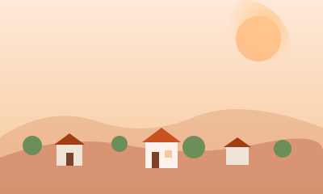

# Promptly — Biome Backgrounds

Sfondi SVG per i 5 biomi del path "vibe coding". Ogni file è full-bleed
(viewBox 1080×360 di base, ma scalano a qualsiasi proporzione).

| File | Biome | Tier | Mood |
|---|---|---|---|
| `biome-mindset.svg` | The Mindset | Free | Villaggio al tramonto, colline soft |
| `biome-prompt.svg`  | The Prompt  | Free | Foresta di parole, fluttuazione tipografica |
| `biome-build.svg`   | The Build   | Pro  | Cantiere/officina di componenti |
| `biome-debug.svg`   | The Debug   | Pro  | Caverna con bug-bot e cristalli |
| `biome-ship.svg`    | The Ship    | Pro  | Skyline al mattino, deploy in volo |

## Uso
```html

```

Sono pensati per stare dietro al path serpeggiante con un piccolo gradient
fade in alto e in basso per fondersi tra biomi adiacenti.
